# Results

All numbers come from `python -m kalman_research.experiments` with the default seed (2026). The JSON summaries are in `results/`, the figures in `results/figures/`. RMSE is the root mean square of the 2D Euclidean position error, so raw measurements with per-axis noise σ have RMSE σ√2.

## Scenarios

**Tracking** (E1, E2, E3, E5). A 2D target with nearly constant velocity, sampled at 10 Hz. True manoeuvre intensity σ_a = 0.5 m/s², position sensor noise σ_z = 2 m per axis unless stated. The initial state is drawn from the same prior the filter is given, so the filter starts honest.

**GPS + IMU** (E4). A figure-eight path about 100 m wide, 60 s long. Accelerometer at 100 Hz with white noise 0.2 m/s², initial bias drawn with standard deviation 0.15 m/s² per axis, and a bias random walk of 0.005 m/s²/√s. GPS at 1 Hz with 3 m noise per axis.

## E1. Kalman filter against model-free smoothing

500 runs per noise level, 800 steps, first 400 discarded. The moving average and exponential smoother are given their best window and smoothing factor for each noise level, selected using the truth, so they are as strong as they can be.

| σ_z (m) | Raw | Moving average (window) | Exp. smoothing (α) | Kalman | Kalman, Riccati prediction |
|---|---|---|---|---|---|
| 0.5 | 0.706 | 0.592 (2) | 0.598 (0.8) | 0.256 | 0.257 |
| 1 | 1.415 | 1.042 (3) | 1.022 (0.6) | 0.440 | 0.436 |
| 2 | 2.827 | 1.704 (4) | 1.705 (0.4) | 0.732 | 0.739 |
| 5 | 7.08 | 3.297 (6) | 3.322 (0.3) | 1.479 | 1.479 |
| 10 | 14.15 | 5.299 (10) | 5.347 (0.2) | 2.496 | 2.495 |

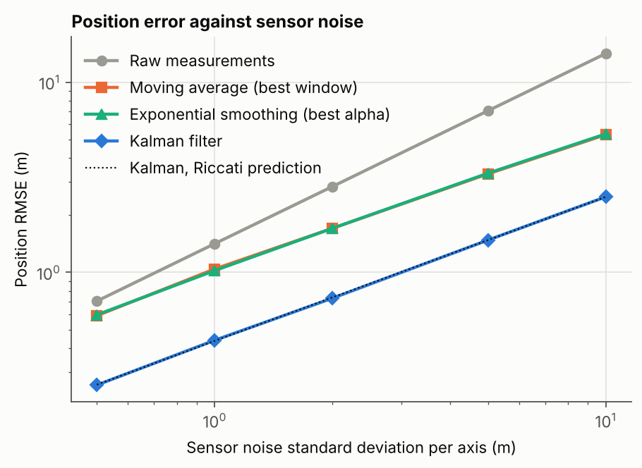

- The Kalman filter's error is 2.1 to 2.3 times lower than the best baseline at every noise level.
- The reason is lag. A smoother can only reduce noise by averaging over a longer window, and on a moving target a longer window means the estimate trails behind. The Kalman filter estimates velocity and uses it to predict forward, so it can average without lagging.
- The measured Kalman RMSE matches the closed-form prediction within about 1%, which validates the implementation.
- The baselines give no velocity. The Kalman filter's velocity RMSE is 0.26 to 0.56 m/s across these noise levels.

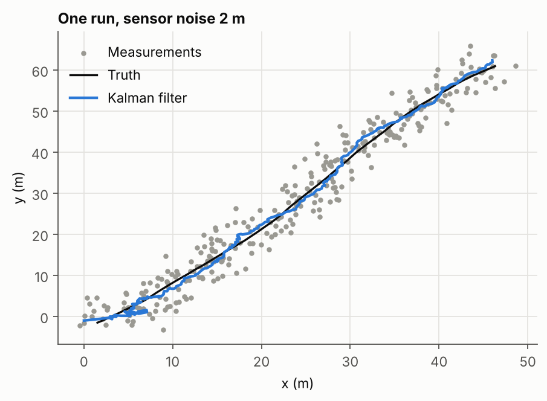

## E2. The cost of mis-tuning Q and R

The filter assumes Q_f = a·Q and R_f = b·R for a, b from 10⁻³ to 10³. Results are exact steady-state values from the Lyapunov equation (theory, section 5).

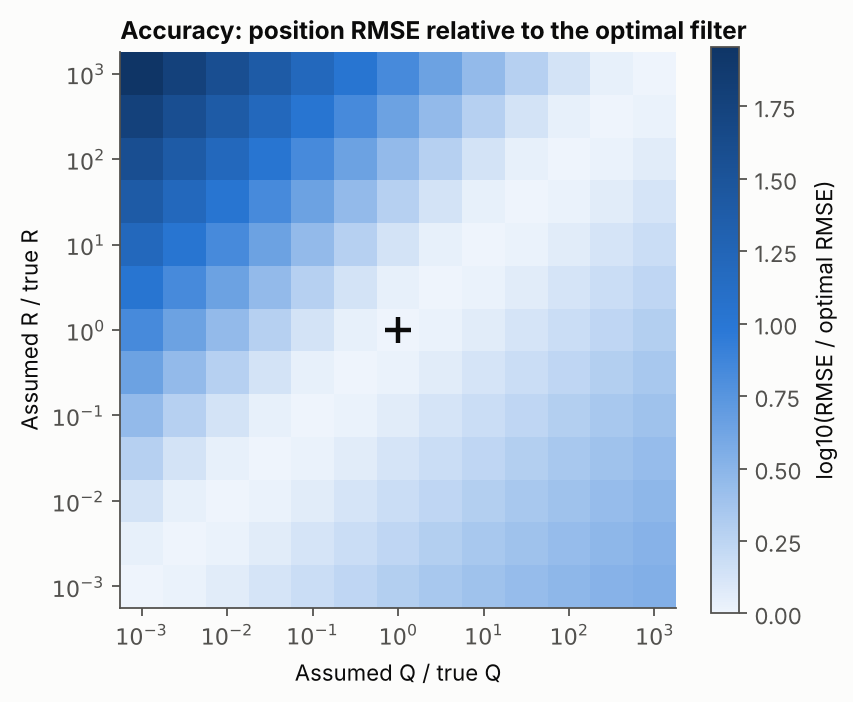
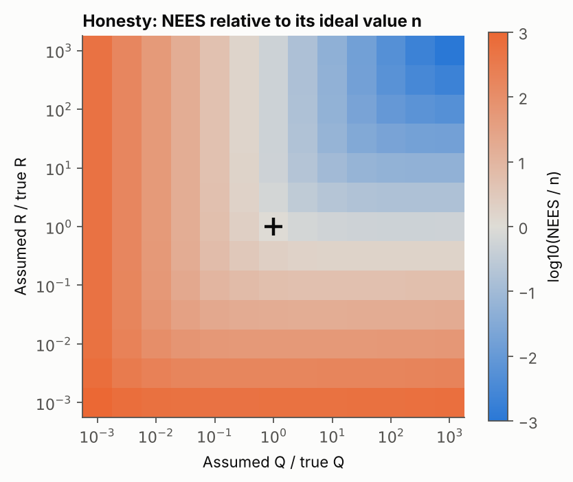

**Finding 1: accuracy depends only on the ratio.** Along the diagonal a = b the RMSE is identical to the optimum (inflation 1.000 at all 13 points) while NEES/n goes from 1000 down to 0.001. A filter can be exactly as accurate as the optimal one while its reported uncertainty is wrong by a factor of a thousand.

**Finding 2: the cost is asymmetric.** With R correct:

| Assumed Q / true Q | 10⁻³ | 10⁻² | 10⁻¹ | 1 | 10 | 10² | 10³ |
|---|---|---|---|---|---|---|---|
| RMSE / optimal | 6.75 | 2.87 | 1.35 | 1.00 | 1.17 | 1.51 | 1.96 |

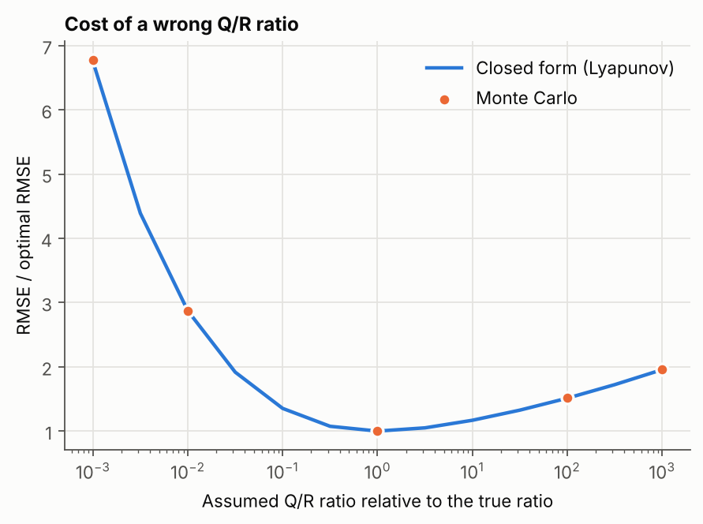

Assuming too little process noise is much worse than assuming too much. With Q too small the filter trusts its constant-velocity prediction and stops listening to the sensor, so when the target does manoeuvre the error grows without a ceiling. With Q too large the filter leans on the sensor, and its error is capped by the sensor noise (the raw-measurement RMSE is 3.8 times the optimum here). Practical rule: when unsure, err towards larger Q.

**Monte Carlo check** (400 runs, 500 steady-state steps each):

| Q scale | R scale | RMSE theory | RMSE simulated | NEES theory | NEES simulated |
|---|---|---|---|---|---|
| 10⁻³ | 1 | 4.991 | 5.009 | 1999 | 1992 |
| 10⁻² | 1 | 2.123 | 2.125 | 201.4 | 201.9 |
| 1 | 1 | 0.739 | 0.741 | 4.000 | 4.009 |
| 10² | 1 | 1.117 | 1.119 | 2.075 | 2.083 |
| 10³ | 1 | 1.446 | 1.446 | 2.101 | 2.103 |
| 10⁻² | 10⁻² | 0.739 | 0.741 | 400.0 | 400.9 |
| 10² | 10² | 0.739 | 0.741 | 0.040 | 0.040 |

Theory and simulation agree within 0.4%.

## E3. Detecting mis-tuning

Three filters on the same 200 runs. 95% acceptance intervals for the run-averaged statistics: NEES in [3.62, 4.40], NIS in [1.73, 2.29].

| Filter | Position RMSE (m) | Mean NEES (ideal 4) | Steps inside NEES interval | Mean NIS (ideal 2) | Steps inside NIS interval | Innovation autocorrelation, lag 1 |
|---|---|---|---|---|---|---|
| Matched | 0.74 | 4.03 | 95% | 2.00 | 96% | 0.003 |
| Overconfident (Q/100) | 1.99 | 190.9 | 0% | 2.95 | 7% | 0.227 |
| Conservative (Q×100) | 1.12 | 2.09 | 0% | 1.88 | 86% | −0.053 |

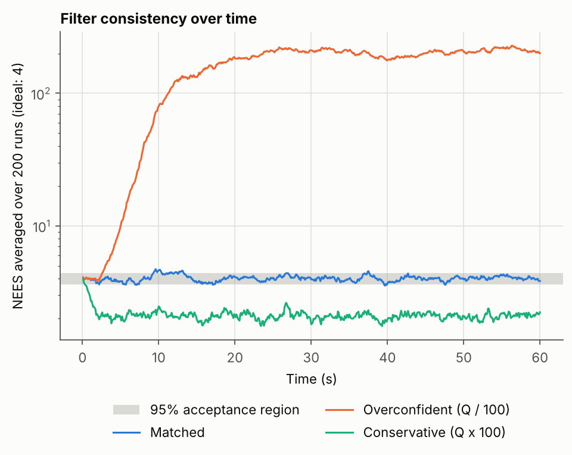
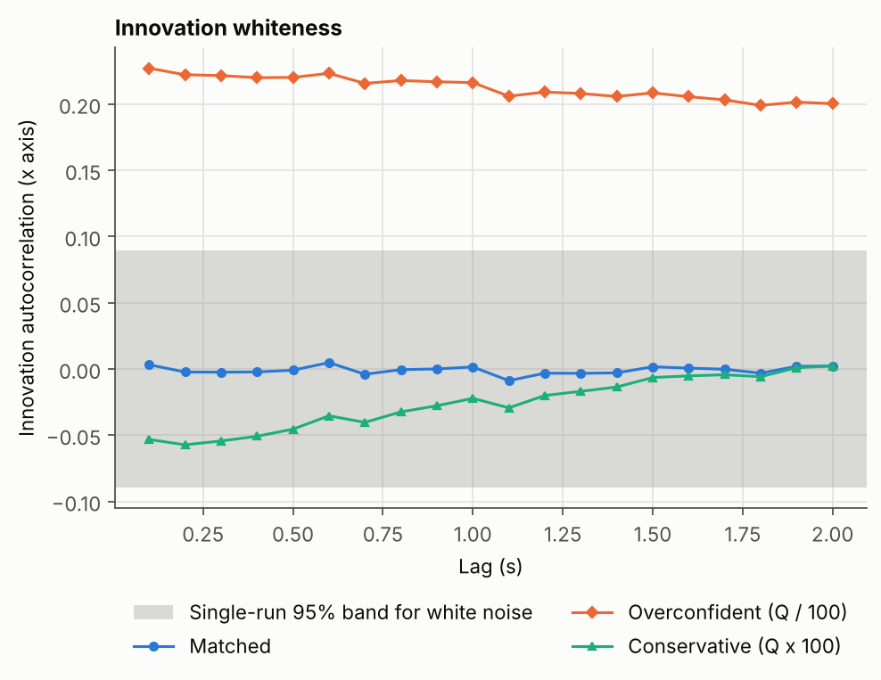

- The matched filter sits inside the interval about 95% of the time, as a correct filter should.
- NEES catches both mis-tuned filters, but NEES needs ground truth, which a deployed system does not have.
- NIS, which needs no truth, catches the overconfident filter but lets the conservative one through 86% of the time. Its mean NIS of 1.88 is only 6% below the ideal value.
- Innovation whiteness separates all three. The overconfident filter's innovations are positively correlated for more than 2 s (it keeps making the same error). The conservative filter's are negatively correlated at short lags (it over-corrects).
- Practical consequence: tune on the field with NIS **and** the innovation autocorrelation, not NIS alone.

## E4. GPS + IMU fusion

200 runs, RMSE over 10 s to 60 s. NEES is computed on the position-velocity block (ideal value 4).

| Estimator | Position RMSE (m) | Velocity RMSE (m/s) | NEES (ideal 4) |
|---|---|---|---|
| GPS, last fix held | 5.23 | – | – |
| IMU dead reckoning | 183.3 | 7.85 | – |
| Kalman filter, GPS only | 4.23 | 2.38 | 2.61 |
| Fused, bias ignored | 21.4 | 3.21 | 1474 |
| Fused, bias estimated | **2.31** | **0.44** | 3.95 |

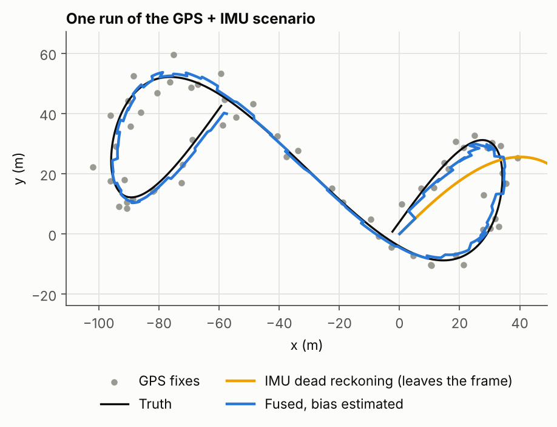
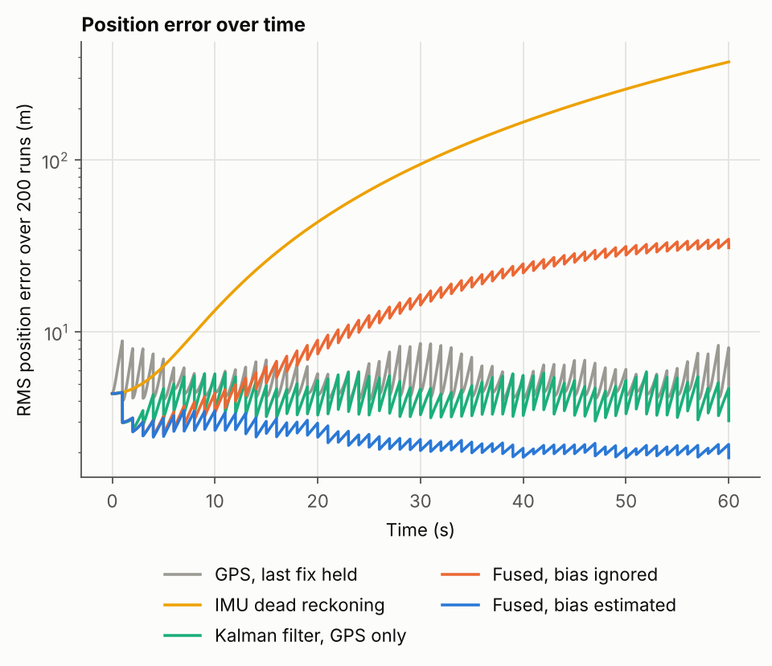

- **Dead reckoning is unusable alone.** The uncorrected bias integrates twice into position; error reaches 100 m by about 30 s.
- **Naive fusion is worse than no fusion.** The four-state filter is told the accelerometer has only 0.2 m/s² of white noise, so it trusts the IMU almost completely and absorbs GPS corrections slowly. The unmodelled bias makes it 5 times worse than the GPS-only filter, and its NEES of 1474 shows it has no idea.
- **Modelling the bias fixes it.** The six-state filter is 1.8 times more accurate in position than the best GPS-only filter and 5.5 times more accurate in velocity, and it is consistent (NEES 3.95).
- The bias error falls from 0.205 m/s² to 0.029 m/s² over the run, although no sensor measures bias.
- The GPS-only filter's process noise was selected from a grid by lowest RMSE (best value 16 m/s² per 10 ms step), so it is the strongest version of that baseline.

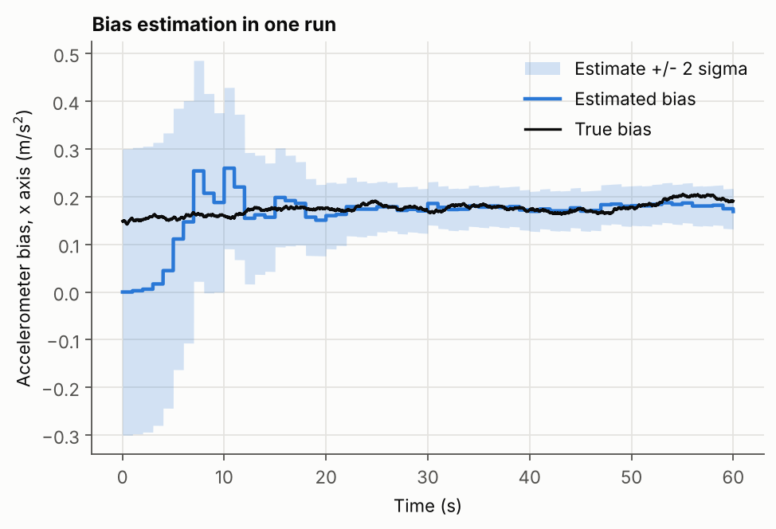

**GPS outage, 30 s to 45 s** (same tuning as above):

| Estimator | RMSE during outage (m) | Error at end of outage (m) |
|---|---|---|
| GPS, last fix held | 46.5 | 56.4 |
| IMU dead reckoning | 150.1 | 206.6 |
| Kalman filter, GPS only | 32.8 | 74.9 |
| Fused, bias ignored | 49.9 | 83.2 |
| Fused, bias estimated | **6.6** | **11.0** |

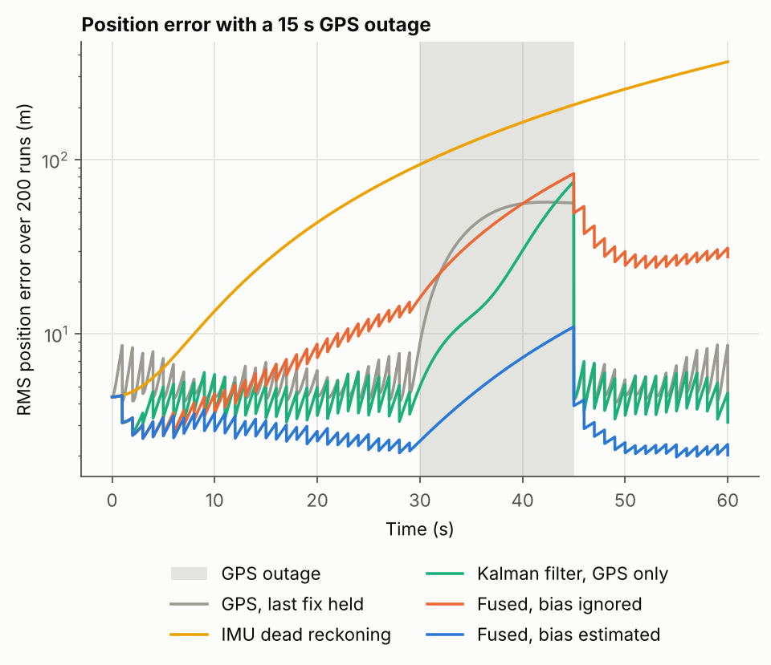

During an outage the fused filter is dead reckoning, but with a bias that was calibrated while GPS was available. That is why it loses 11 m in 15 s where the others lose 56 to 207 m. The GPS-only filter extrapolates a straight line through a curve and ends worse than simply holding the last fix.

## E5. Adaptive measurement noise

100 runs, forgetting factor 0.98 (memory of about 50 updates, 5 s).

**Part A: constant R, wrong initial guess.** RMSE over the last 60 s of a 90 s run. Oracle RMSE is 0.733 m.

| Initial R / true R | Fixed RMSE (m) | Adaptive RMSE (m) | Fixed NEES | Adaptive NEES | Adaptive final σ̂_z (true 2.0) |
|---|---|---|---|---|---|
| 0.01 | 1.118 | 0.735 | 207.8 | 4.07 | 1.99 |
| 0.1 | 0.863 | 0.735 | 22.3 | 4.07 | 1.99 |
| 1 | 0.733 | 0.735 | 4.00 | 4.07 | 1.99 |
| 10 | 0.980 | 0.735 | 2.16 | 4.06 | 1.99 |
| 100 | 2.098 | 0.735 | 1.96 | 4.00 | 1.99 |

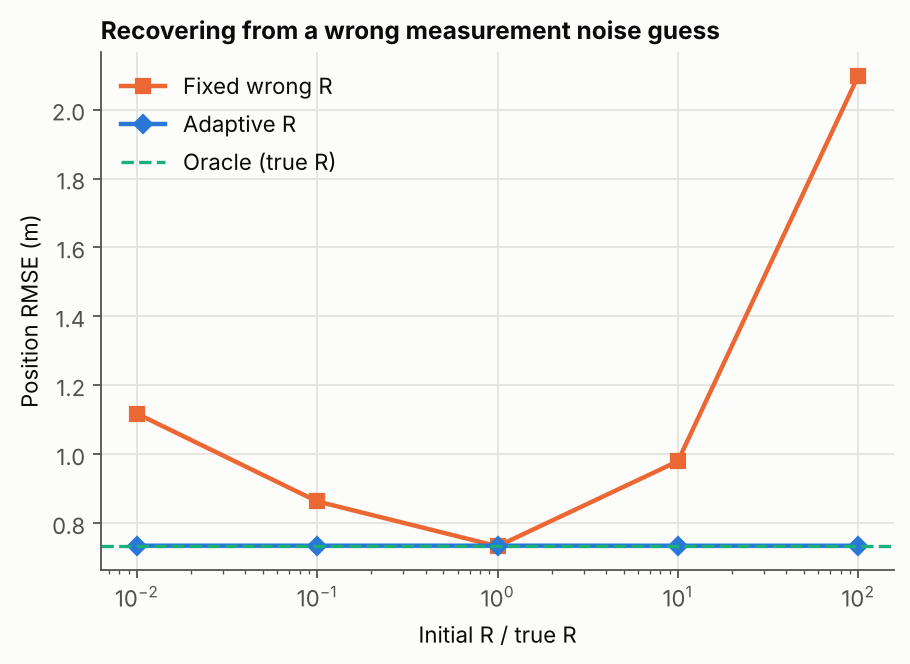

The adaptive filter converges to the same answer from every starting point and ends within 0.3% of the oracle RMSE. The price of adapting when nothing is wrong (the row with ratio 1) is 0.2% in RMSE.

**Part B: the sensor degrades from 2 m to 8 m between 30 s and 60 s.** Segment values skip the 10 s after each change.

| Filter | RMSE before | RMSE degraded | RMSE after | NEES before | NEES degraded | NEES after |
|---|---|---|---|---|---|---|
| Fixed nominal R | 0.740 | 2.549 | 0.748 | 4.04 | 32.8 | 4.09 |
| Adaptive R | 0.742 | 2.042 | 0.768 | 4.09 | 4.14 | 3.38 |
| Oracle R | 0.740 | 2.044 | 0.748 | 4.04 | 3.90 | 4.09 |

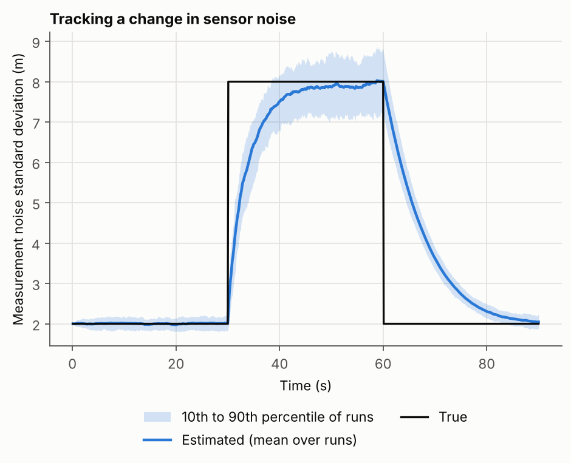
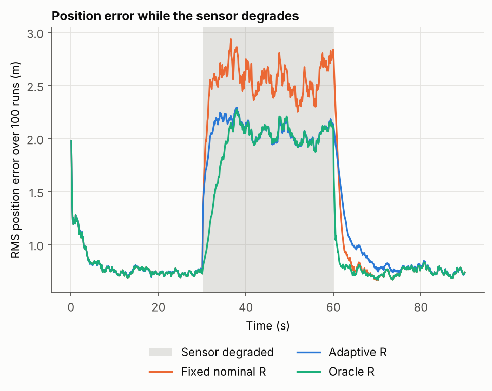
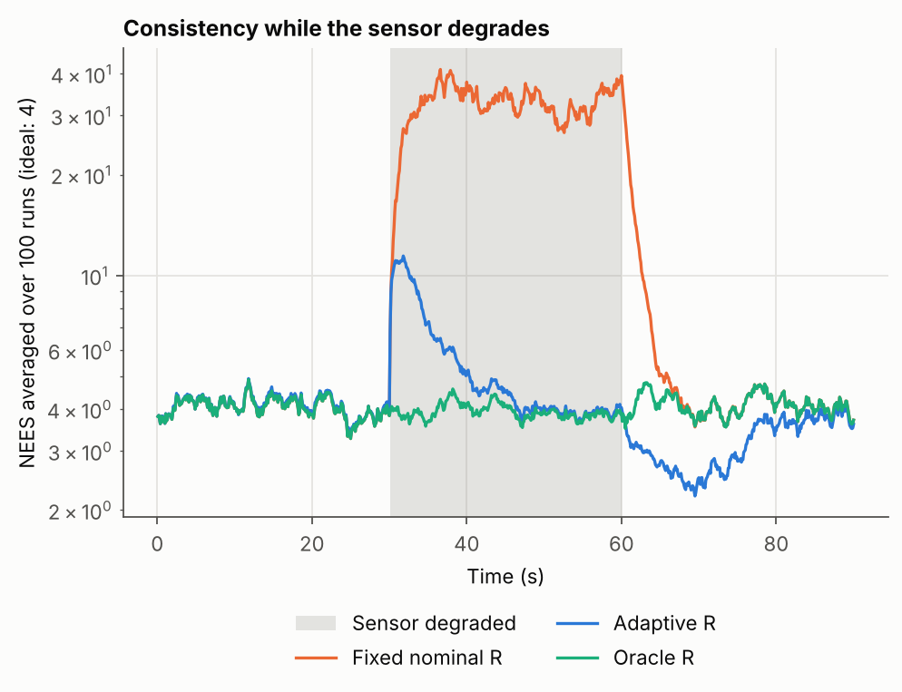

- Once settled, the adaptive filter matches the oracle in the degraded segment (2.04 m against 2.55 m for the fixed filter, a 20% reduction) and stays consistent where the fixed filter's NEES rises to 33.
- **Limitation: lag.** For the first few seconds after the sensor degrades the adaptive filter is still overconfident (NEES peaks near 10). After the sensor recovers, the estimate of R decays slowly, so the filter is conservative (NEES 3.4) and slightly less accurate (0.768 m against 0.748 m) for about 20 s. A shorter memory reacts faster but gives a noisier R estimate.
